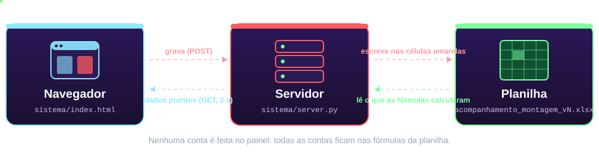

<div align="center">


<br>


**Painel web estilo Power BI, sincronizado nos dois sentidos com uma planilha Excel.**
O que você digita no painel aparece na planilha. O que você muda no Excel aparece no painel em até 2 segundos.


</div>

<p align="center"></p>

> **Projeto não oficial.** *Operação Big Hero*, *Big Hero 6* e *Baymax* são marcas da Disney. Este repositório usa **apenas arte original** inspirada no tema, sem imagens oficiais, e não tem qualquer vínculo com a Disney.
>
> **Repositório privado.** Contém uma planilha de exemplo com os nomes das etapas da SoBot. Não o torne público sem revisar o conteúdo e confirmar a autorização da empresa.

## 🩺 Diagnóstico rápido

**O painel não faz nenhuma conta.** Progresso, pesos, tempos e dias úteis são calculados pelas **fórmulas da própria planilha**. O painel apenas mostra o resultado e grava nas células amarelas (de entrada). Assim, o número do painel é sempre igual ao do Excel.

O fluxo de trabalho que a planilha implementa:

| # | Passo | O que acontece |
|:-:|---|---|
| 1 | **Subatividades e tempo ideal** | O tempo de cada subatividade define o seu **peso** dentro da etapa. |
| 2 | **Meta de robôs** | Vira as "previstas" de todas as etapas. |
| 3 | **Peças concluídas** | Você informa quantas peças de cada subatividade já estão prontas. |
| 4 | **Duas visões do progresso** | **Tabela 1 (tarefas):** conta as parciais, e tudo em 90% dá 90%. **Tabela 2 (unidades):** só conta unidade 100% pronta, e 3 de 10 dá 30%. |
| 5 | **Equipe** | Pessoas × horas por dia = dias úteis restantes. |

<p align="center"></p>

## 🏙️ San Fransokyo (arquitetura)

<div align="center">

</div>

| Arquivo | Papel |
|---|---|
| [`sistema/server.py`](sistema/server.py) | Servidor Flask. Lê e grava a planilha, valida o que a tela envia e expõe a API. |
| [`sistema/index.html`](sistema/index.html) | A tela inteira (HTML + CSS + JavaScript, gráficos com [ECharts](https://echarts.apache.org/)). |
| [`sistema/iniciar_painel.bat`](sistema/iniciar_painel.bat) | Dois cliques para ligar. |
| [`sistema/requirements.txt`](sistema/requirements.txt) | Dependências Python. |
| [`acompanhamento_montagem_v4.xlsx`](acompanhamento_montagem_v4.xlsx) | **Planilha de exemplo** (3 abas: Acompanhamento, Equipe, Como funciona). |
| [`docs/`](docs) | Arte animada deste README (SVGs). |

<details>
<summary><b>📡 API (clique para abrir)</b></summary>

| Método | Rota | O que faz |
|---|---|---|
| `GET` | `/` | Entrega `index.html`. |
| `GET` | `/api/data` | Devolve todos os dados atuais da planilha (a tela consulta a cada 2 s). |
| `POST` | `/api/set` | Recebe `{"changes":[{"cell":"Acompanhamento!D15","value":5}]}`, valida, grava no Excel e devolve os dados recalculados. |

</details>

<details>
<summary><b>🔌 Como o servidor fala com o Excel (clique para abrir)</b></summary>

* **Planilha aberta no Excel:** o servidor localiza a janela aberta (Running Object Table do Windows, inclusive abertas via OneDrive/SharePoint), lê e grava **ao vivo** e salva.
* **Planilha fechada:** lê o arquivo com `openpyxl` e, para gravar, abre um **Excel invisível** que fecha sozinho 12 s depois da última edição. Usar o Excel de verdade preserva gráficos e fórmulas e garante o recálculo.
* Todas as chamadas ao Excel passam por **uma única thread** (exigência do COM).

</details>

## 🔬 Escaneando a planilha (descoberta do layout)

O servidor **não usa linhas fixas**. Ele procura títulos na coluna A (`Subatividade`, `Unidades previstas`, `Indicadores`, `Tabela 1`, `Tabela 2`, `Separação de materiais`). Se uma versão nova da planilha mover as linhas, o painel continua funcionando. Ele usa sempre a **maior versão** `acompanhamento_montagem_vN.xlsx` da pasta.

<p align="center"></p>

## 🛠️ Ativando o assistente (como rodar)

**Requisitos**

* Windows com **Microsoft Excel** instalado (o controle é via COM).
* **Python 3.10+**.
* Internet na primeira abertura (a biblioteca de gráficos vem de uma CDN).

**Passo a passo**

```bash
git clone <url-deste-repositorio>
cd painel-montagem-sobot/sistema
python -m pip install -r requirements.txt
python server.py
```

Ou dê dois cliques em `sistema/iniciar_painel.bat`. O painel abre em <http://localhost:8765>. **Deixe a janela preta aberta** enquanto usar: fechá-la desliga o painel.

Opções do `server.py`: `--no-browser` (não abre o navegador) e `--force` (ignora outro servidor já ativo na rede).

**Uso em rede.** O primeiro PC que abre o painel vira o **servidor** e registra o endereço em `sistema/servidor.txt`. Quem abrir depois, em outro PC, é redirecionado para ele, de modo que só um servidor grava na planilha.

## 🛡️ Protocolo de segurança

> [!WARNING]
> O servidor escuta em `0.0.0.0` e **não tem login**. Qualquer pessoa que alcance a porta 8765 pode ver e **editar** a planilha. Use apenas em rede confiável ou VPN.

* Só as **células amarelas** (lista branca, recalculada a cada pedido) podem ser gravadas. Fórmulas nunca são sobrescritas.
* O servidor valida cada valor (sem negativos, inteiros onde exigido, peças ≤ meta), além da validação da tela.
* Todo texto vindo da planilha é escapado antes de entrar na página (`esc()`), evitando injeção de HTML.

## 🧪 Limitações conhecidas

* Só funciona em **Windows + Excel** (não dá para hospedar em Linux ou numa nuvem comum).
* Sem autenticação nem histórico de alterações.
* As 24 etapas e a estrutura da planilha são as da SoBot (não há tela para criar etapas novas).

## 🚀 Próximas atualizações de armadura

- [ ] Trocar o COM por **Microsoft Graph (Excel Online)** para hospedar fora do PC da empresa, mantendo a planilha como fonte.
- [ ] Ou substituir a planilha por **banco de dados** (Postgres), com importação e exportação de Excel.
- [ ] Login e perfis (só ver / editar).
- [ ] Histórico de mudanças.
- [ ] Etapas configuráveis pela tela.

## 📚 Para quem vai mexer no código

Os arquivos `server.py` e `index.html` são **bastante comentados em português**. Cada função tem uma docstring explicando o que faz, e os trechos menos óbvios (COM, descoberta de layout, validações) explicam o porquê.

As animações deste README são **SVGs originais**, gerados pelo script [`docs/gerar_arte.py`](docs/gerar_arte.py) (`python docs/gerar_arte.py docs` refaz todos): estrelas que piscam, microbots voando pela ponte, lanternas balançando, o assistente flutuando, piscando e com o scanner passando, a fala digitada e os dados trafegando entre as caixas da arquitetura. Funcionam nos temas claro e escuro do GitHub.

<br>

<div align="center">

</div>
